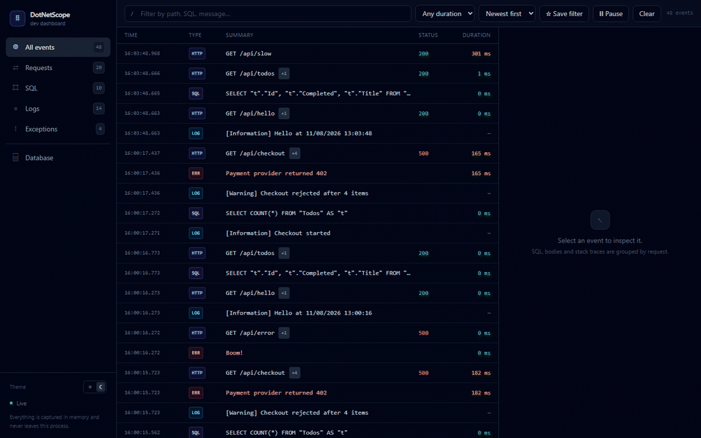

<picture>
  <source media="(prefers-color-scheme: dark)" srcset="assets/banner-dark.svg?v=2">
  
</picture>

  
  
  
  

### I lead .NET teams — and I still write the code.

Twelve years in .NET: a SQL Server seat at Wildberries in 2014, full-stack at AlfaStrakhovanie and OZON, senior backend at Softeq, marketplace team lead at THE LIST, and now head of development at Bioniq. I keep shipping on my own time, because a lead who has stopped shipping loses the ability to judge what the team ships.

Wildberries · AlfaStrakhovanie · OZON · Softeq · THE LIST · Bioniq

---

## Currently building: DotNetScope

**A self-hosted dev dashboard for ASP.NET Core.** Every HTTP request, EF Core command, `ILogger` record and exception lands in one timeline — grouped by the request that caused it. Three lines to install, one embedded React UI at `/_dashboard`, no agent, no cloud account, nothing leaving your machine.

It exists because debugging a 500 means asking one question over and over: *“which SQL ran, and what did the log say right before it blew up?”*

**What's actually inside — the parts that took the thinking:**

- **Correlation without ceremony.** Middleware stamps an `AsyncLocal` request id; an `ILoggerProvider` and an EF Core `DiagnosticListener` subscriber read it, so SQL and logs attach to the right request even under concurrency.
- **Bounded by design.** A ring buffer (1,000 events by default), capped request/response bodies, and a response stream that is copied — never buffered whole.
- **Silent until you ask.** Every `/_dashboard` route answers `403` unless the caller is loopback; remote access is opt-in, and `Enabled = false` removes it entirely.
- **No OpenTelemetry dependency.** Trace and span ids come straight from `Activity.Current`, so they match whatever your backend already exports.
- **Tested against a real host.** NUnit integration tests start Kestrel, hit endpoints, and assert on the telemetry that was captured — not on mocks.
- **Shipped like a product.** MIT, CI + release workflows, Dependabot, embedded README in the NuGet package, Keep a Changelog, SECURITY.md, and a roadmap that admits what's missing.

  
  
  

---

## Background

Selected roles — the full history, with the details, is on [LinkedIn](https://www.linkedin.com/in/kirill-persionov-ba6b8a9a/).

| Period | Role |
|:--|:--|
| **2025 — now** | **Head of Development** · Bioniq — health-tech platform, remote |
| **2024** | **Marketplace Team Lead** · THE LIST |
| **2022 — 2024** | **Independent contractor (ИП)** — contract work under my own legal entity |
| **2021 — 2022** | **Senior .NET Engineer** · Softeq — Vilnius, Lithuania |
| **2020 — 2021** | **Full-Stack Engineer** · OZON |
| **2018 — 2020** | **Full-Stack Engineer** · AlfaStrakhovanie — investment and financial market |
| **2017 — 2018** | **Head of DevOps** · Manzanica |
| **2014 — 2017** | **Developer** · Wildberries → Manzana Group → LOGISTIX — ERP, CRM, WMS |

What runs through all of it: high-traffic commerce, money, and logistics — domains where a wrong query is not an abstraction, it is a customer seeing the wrong price.

---

## Stack

| Layer | What I work with |
|:--|:--|
| **Backend** | C# · .NET 10 · ASP.NET Core (Minimal APIs, middleware, DI) · SignalR · `ILogger` · `DiagnosticSource` |
| **Data** | EF Core · SQL Server · SQLite · schema-safe, parameterised SQL |
| **Frontend** | React · TypeScript · Tailwind CSS · Vite |
| **Testing** | NUnit · integration tests on a real Kestrel host · security cases |
| **Delivery** | GitHub Actions · NuGet packaging · MSBuild · Dependabot |
| **Observability** | Structured logging · W3C `traceparent` · `Activity` / OpenTelemetry semantics |

---

## How I write software

| Principle | What that means in practice |
|:--|:--|
| **Boring beats clever.** | Predictable code that a teammate can change next quarter is worth more than the smartest 40 lines in the repo. |
| **Defaults are the product.** | Zero-config first. Options exist for the 10% who need them, never as an excuse for unsafe defaults. |
| **Correlation over volume.** | A thousand log lines are noise. One request with its children attached is an answer. |
| **Docs ship with the feature.** | If the README doesn't explain it, it isn't finished — that's why DotNetScope has an EN and an RU version. |

---

## Looking for

**Head of Engineering / Tech Lead** — product teams, .NET-heavy, remote-first. Based in Pyatigorsk (UTC+3), and I work remotely on a permanent basis.

The part I care about is the seam between architecture and delivery: a team that has to stay honest, a codebase that survives its own success, and decisions that are still defensible a year later. I'm not looking for a role where the code stops at the diagram.

---

## Contact

The fastest way to reach me is [Telegram](https://t.me/PersiOnOf) or [e-mail](mailto:kspersionov@gmail.com); here on GitHub and on [LinkedIn](https://www.linkedin.com/in/kirill-persionov-ba6b8a9a/) also works. I answer questions about DotNetScope's internals happily — it's the best code I've written, and I'd rather be judged on it than on a list of buzzwords.

  

<b>По-русски</b>

### Кирилл Персионов — руководитель разработки, .NET

Двенадцать лет в .NET: в 2014-м писал SQL Server в Wildberries, дальше фулстек в АльфаСтраховании и OZON, senior-бэкенд в Softeq, 2022–2024 — через своё ИП, тимлид маркетплейса в THE LIST, сейчас руковожу отделом разработки в Bioniq. Продолжаю писать код сам — руководитель, который перестал выпускать продукт, теряет право судить о том, что выпускает команда.

**Сейчас делаю DotNetScope** — self-hosted дашборд для ASP.NET Core. HTTP-запросы, SQL из EF Core, логи и исключения в одной ленте, сгруппированные по запросу, который их породил. Ставится тремя строчками, UI на React встроен в сборку и открывается по `/_dashboard`, агента и облака нет — данные не покидают машину.

Внутри: корреляция через `AsyncLocal` и `DiagnosticListener`, кольцевой буфер с жёсткими лимитами, защита по loopback (все маршруты отдают 403, пока запрос не локальный), trace/span id из `Activity.Current` без зависимости от OpenTelemetry, интеграционные тесты на настоящем Kestrel через NUnit, CI, релизный workflow, Dependabot, CHANGELOG и документация на двух языках.

**Стек:** C#, .NET 10, ASP.NET Core, SignalR, EF Core, SQL Server, SQLite, React, TypeScript, Tailwind, Vite, NUnit, GitHub Actions, NuGet.

**Ищу:** Head of Engineering / Tech Lead — продуктовые команды, .NET, удалёнка. Живу в Пятигорске (UTC+3), работаю удалённо постоянно.

**Связаться:** [Telegram](https://t.me/PersiOnOf), [kspersionov@gmail.com](mailto:kspersionov@gmail.com), [LinkedIn](https://www.linkedin.com/in/kirill-persionov-ba6b8a9a/) — или сообщение здесь, на GitHub.

